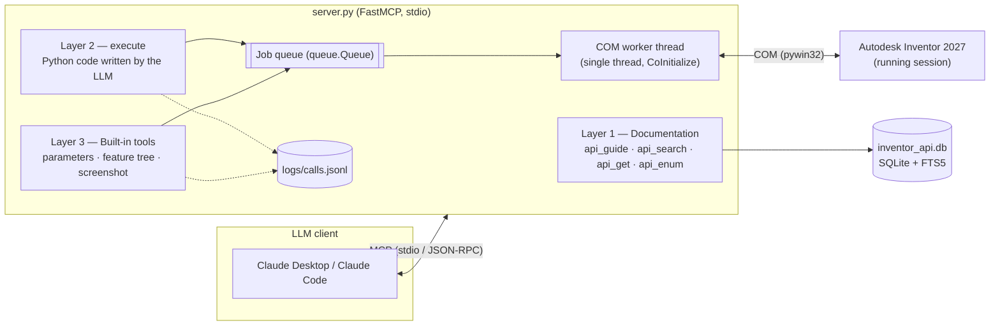
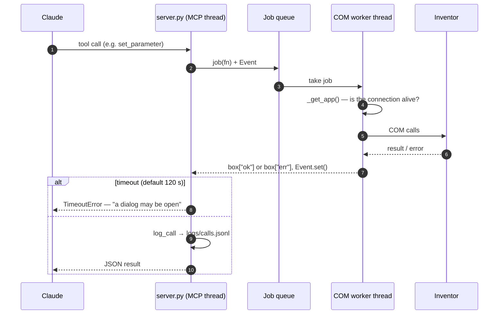
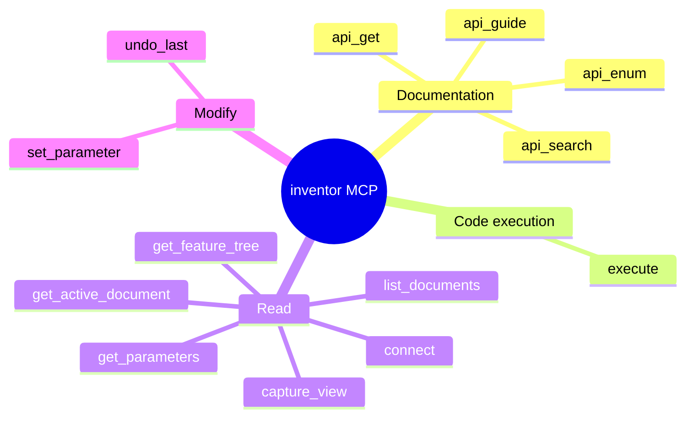
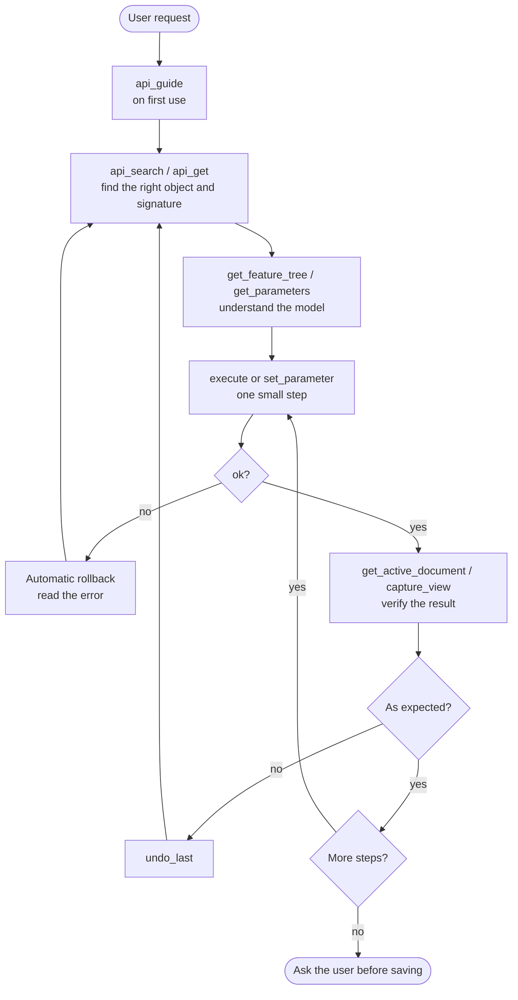
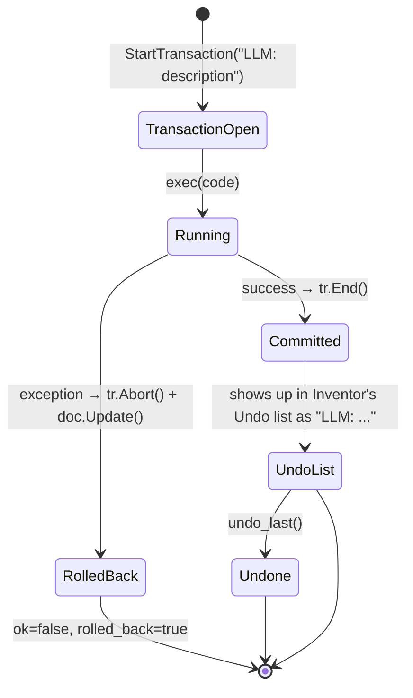

# Inventor LLM

An [MCP](https://modelcontextprotocol.io) server that bridges Claude (or any MCP-capable LLM client) and **Autodesk Inventor 2027**. The server connects to a running Inventor session through **Python + COM** (pywin32, dynamic dispatch) and lets the LLM:

- Search the Inventor API documentation,
- Read the model (parameters, feature tree, mass, bounding box, screenshots),
- Run its own Python code inside Inventor, **wrapped in a transaction**.

---

## Contents

- [Architecture](#architecture)
- [Requirements](#requirements)
- [Installation](#installation)
- [Connecting to Claude](#connecting-to-claude)
- [Tools](#tools)
- [The execute environment](#the-execute-environment)
- [Units](#units)
- [Safety and undo](#safety-and-undo)
- [Project layout](#project-layout)
- [Troubleshooting](#troubleshooting)

---

## Architecture



**Key design decisions**

| Decision | Why |
|---|---|
| All COM calls run on **a single worker thread** | COM objects are bound to their apartment; MCP requests arriving on different threads can hang Inventor. |
| `dynamic.Dispatch` (no early binding) | No `makepy` cache needed, and more resilient to Inventor version changes. |
| API documentation stored in local SQLite | The LLM looks up real signatures instead of inventing method names; no network access required. |
| `stdout` is reserved for the MCP protocol | The server never calls `print()`; `print` inside `execute` is captured and returned in the result. |

### Request flow



---

## Requirements

- Windows 10/11
- Autodesk Inventor 2027 (must be **running** while the server is in use)
- Python 3.10+ (developed in a conda environment)
- Packages: `pywin32`, `mcp`

## Installation

```powershell
git clone <repo-url> InventorLLM
cd InventorLLM

conda create -n inventor python=3.11 -y
conda activate inventor
pip install pywin32 "mcp[cli]"
```

`inventor_api.db` (~55 MB) ships with the repo. The server looks for the database in this order:

1. The `INVENTOR_API_DB` environment variable
2. The same folder as `server.py`
3. `~/Desktop/Inventor/inventor_api.db`

Quick test (with Inventor open):

```powershell
mcp dev server.py     # try the tools by hand in the MCP Inspector
```

## Connecting to Claude

**Claude Code**

```powershell
claude mcp add inventor -- C:\path\to\conda\envs\inventor\python.exe C:\path\to\InventorLLM\server.py
```

**Claude Desktop** — `%APPDATA%\Claude\claude_desktop_config.json`:

```json
{
  "mcpServers": {
    "inventor": {
      "command": "C:\\path\\to\\conda\\envs\\inventor\\python.exe",
      "args": ["C:\\path\\to\\InventorLLM\\server.py"]
    }
  }
}
```

---

## Tools



### Layer 1 — Documentation

| Tool | Description |
|---|---|
| `api_guide()` | Guide to using the Inventor API from Python on this server. The LLM reads it on first use. |
| `api_search(query, kind="", limit=12)` | FTS5 (bm25) search across the Reference Manual, User's Manual and samples. `kind`: `object`, `method`, `property`, `event`, `enum`, `sample`, `manual`. |
| `api_get(name, max_chars=12000)` | Full page (`ExtrudeFeatures`, `ExtrudeFeatures.Add`, ...). For methods/properties, the exact signature from the type library is included. |
| `api_enum(query)` | Look up enums by enum name, constant name or numeric value (`kJoin`, `20481`). |

### Layer 2 — Code execution

| Tool | Description |
|---|---|
| `execute(code, description, transaction=True, timeout_s=180)` | Runs LLM-written Python code inside Inventor. Return a value with `result = ...`; `print` output comes back in the `output` field. |

### Layer 3 — Built-in tools

| Tool | Description |
|---|---|
| `connect()` | Inventor version, number of open documents, active document. |
| `list_documents()` | Open documents (name, path, type, unsaved changes). |
| `get_active_document()` | Active document plus mass (kg), volume (mm³), bounding box (mm). |
| `get_parameters(name_filter="")` | Parameters (mm / deg / ul), expression, `user`/`model` kind and owner (feature or sketch). |
| `get_feature_tree()` | Feature tree: order, name, type, suppressed or not. |
| `capture_view(width, height, fit)` | PNG screenshot of the active view. |
| `set_parameter(name, value, unit="mm")` | Changes a parameter and updates the model; returns mass and bbox before/after. |
| `undo_last()` | Undoes the last operation in Inventor. |

### Recommended workflow



---

## The execute environment

These names are available inside `execute` code:

| Name | Contents |
|---|---|
| `app` | `Inventor.Application` |
| `doc` | `app.ActiveDocument` (`None` if no document is open) |
| `cd` | `doc.ComponentDefinition` (parts/assemblies) |
| `tg` | `app.TransientGeometry` |
| `to` | `app.TransientObjects` |
| `C` | Enum constants: `C.kJoinOperation`, `C.kPartDocumentObject` ... (suggests close matches for unknown names) |
| `mm(x)`, `deg(x)` | mm → cm, degrees → radians (for passing to the API) |
| `to_mm(x)`, `to_deg(x)` | cm → mm, radians → degrees |
| `com_type(obj)` | Type name of a COM object (`'ExtrudeFeature'`) |
| `print(...)` | Captures output |
| `result` | Whatever you assign here is returned (COM objects are shown as `<Type 'Name'>`) |

Example:

```python
sk = cd.Sketches.Add(cd.WorkPlanes.Item(3))                     # XY plane
sk.SketchCircles.AddByCenterRadius(tg.CreatePoint2d(0, 0), mm(10))
prof = sk.Profiles.AddForSolid()
ed = cd.Features.ExtrudeFeatures.CreateExtrudeDefinition(prof, C.kJoinOperation)
ed.SetDistanceExtent(mm(20), C.kPositiveExtentDirection)
result = cd.Features.ExtrudeFeatures.Add(ed)
```

## Units

The Inventor API's internal units are always **cm** and **radians** (mass in kg). The server converts user-facing values:

| Unit | Factor (internal → display) |
|---|---|
| `mm` | × 10 |
| `cm` | × 1 |
| `m` | × 0.01 |
| `in` | ÷ 2.54 |
| `deg` | × 180/π |
| `rad`, `ul` | × 1 |

> String expressions follow the OS locale. On a Turkish locale, Inventor expects a decimal **comma** (`"20,5 mm"`), so passing numeric (cm/rad) values is safer.

---

## Safety and undo



- `execute` and `set_parameter` run each call in **a single transaction**; on error, every change is rolled back.
- Successful steps show up in Inventor's Undo list as `LLM: <description>` and can be undone with `undo_last` or manually in Inventor.
- Read-only code can pass `transaction=False`.
- Every `execute`, `set_parameter` and `undo_last` call is written to `logs/calls.jsonl` (timestamp, tool, arguments, result/error).
- ⚠️ `execute` runs **arbitrary Python code** with no sandbox. Only connect the server to clients you trust, and make a copy with `SaveAs` before changing important files.

---

## Project layout

```
InventorLLM/
├── server.py          # MCP server (single file)
├── inventor_api.db    # Inventor API documentation (SQLite + FTS5)
├── logs/              # Runtime logs (git-ignored)
│   └── calls.jsonl
├── .vscode/           # Editor settings (conda environment)
└── README.md
```

### inventor_api.db schema


---

## Troubleshooting

| Symptom | Likely cause / fix |
|---|---|
| `pywintypes.com_error: Operation unavailable` | Inventor isn't running. Start Inventor first. |
| `TimeoutError: Inventor yanıt vermedi` | A dialog box is open in Inventor; close it and try again. |
| `inventor_api.db bulunamadı` | Put the file next to `server.py` or set the `INVENTOR_API_DB` environment variable. |
| `Aktif doküman ... bir parça/montaj değil` | A drawing (`.idw`/`.dwg`) is active; open a part or assembly. |
| `Bilinmeyen sabit: kXxx` | Check the close matches listed in the error, or search with `api_enum`. |
| Parse error in a string expression | Turkish locale: use a comma as the decimal separator, or pass a numeric value. |
| Broken MCP connection / JSON errors | A `print()` may have been added to the server code; stdout is reserved for MCP. |

> The server's own messages and tool descriptions are in Turkish; the error strings above are quoted as they appear.
