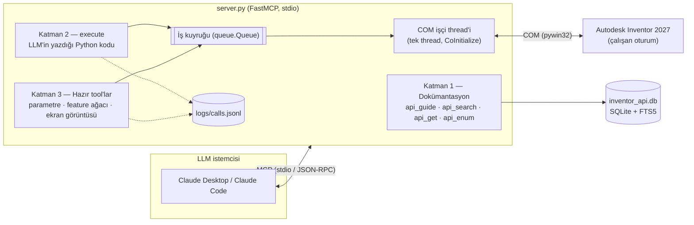
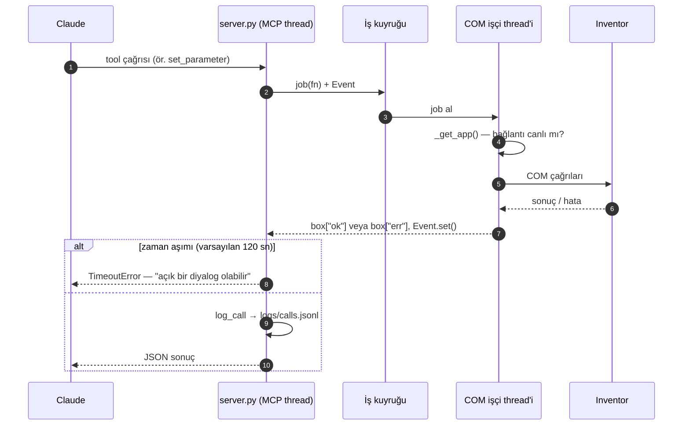
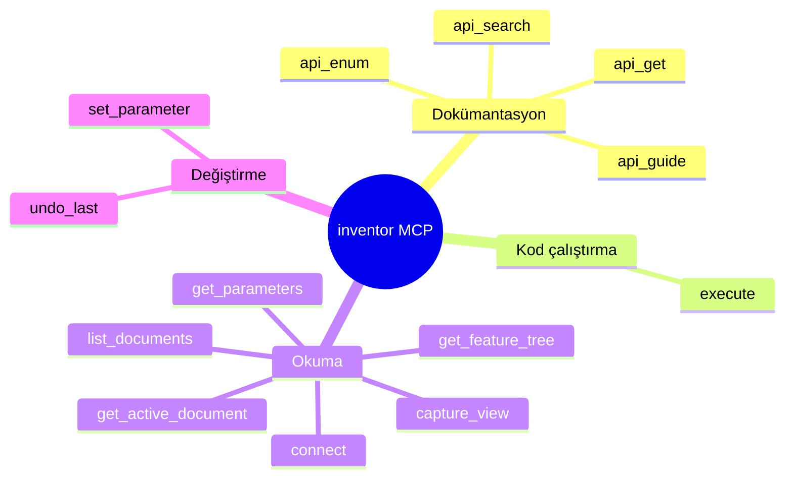
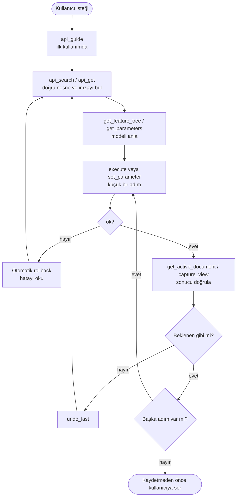
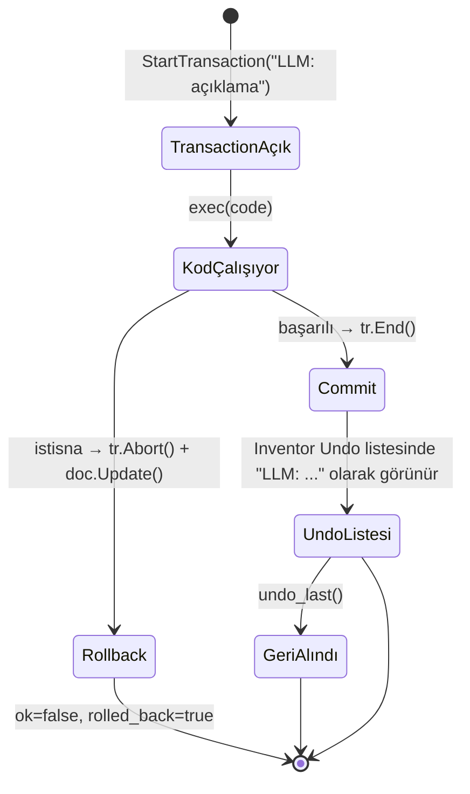
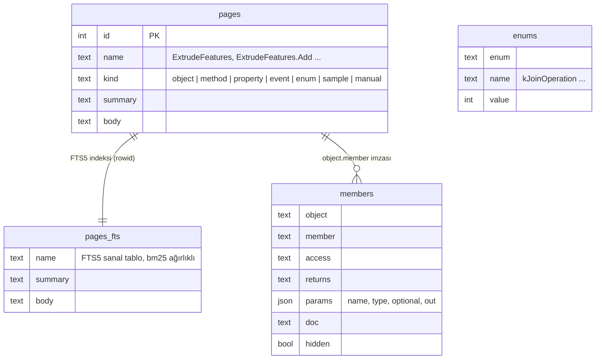

# Inventor LLM

Claude (veya MCP destekleyen herhangi bir LLM istemcisi) ile **Autodesk Inventor 2027** arasında köprü kuran bir [MCP](https://modelcontextprotocol.io) sunucusu. Sunucu, çalışan Inventor oturumuna **Python + COM** (pywin32, dynamic dispatch) üzerinden bağlanır ve LLM'in:

- Inventor API dokümantasyonunda arama yapmasını,
- Modeli okumasını (parametreler, feature ağacı, kütle, sınır kutusu, ekran görüntüsü),
- Kendi yazdığı Python kodunu Inventor içinde **transaction güvencesiyle** çalıştırmasını

sağlar.

---

## İçindekiler

- [Mimari](#mimari)
- [Gereksinimler](#gereksinimler)
- [Kurulum](#kurulum)
- [Claude'a bağlama](#claudea-bağlama)
- [Tool'lar](#toollar)
- [execute ortamı](#execute-ortamı)
- [Birimler](#birimler)
- [Güvenlik ve geri alma](#güvenlik-ve-geri-alma)
- [Dosya yapısı](#dosya-yapısı)
- [Sorun giderme](#sorun-giderme)

---

## Mimari



**Temel tasarım kararları**

| Karar | Neden |
|---|---|
| Tüm COM çağrıları **tek bir işçi thread'inde** | COM nesneleri apartment'a bağlıdır; MCP isteklerinin farklı thread'lerden gelmesi Inventor'ı kilitleyebilir. |
| `dynamic.Dispatch` (early binding yok) | `makepy` önbelleğine gerek kalmaz, Inventor sürüm değişikliklerine dayanıklıdır. |
| API dokümantasyonu yerel SQLite'ta | LLM'in metot adı uydurması yerine gerçek imzaya bakmasını sağlar; ağ erişimi gerekmez. |
| `stdout` yalnızca MCP protokolüne ayrılmış | Sunucu kodunda `print()` kullanılmaz; `execute` içindeki `print` yakalanıp sonuca eklenir. |

### İstek akışı



---

## Gereksinimler

- Windows 10/11
- Autodesk Inventor 2027 (sunucu çalışırken **açık** olmalı)
- Python 3.10+ (proje conda ortamıyla geliştirildi)
- Paketler: `pywin32`, `mcp`

## Kurulum

```powershell
git clone <repo-url> InventorLLM
cd InventorLLM

conda create -n inventor python=3.11 -y
conda activate inventor
pip install pywin32 "mcp[cli]"
```

`inventor_api.db` (~55 MB) repoyla birlikte gelir. Sunucu veritabanını şu sırayla arar:

1. `INVENTOR_API_DB` ortam değişkeni
2. `server.py` ile aynı klasör
3. `~/Desktop/Inventor/inventor_api.db`

Hızlı test (Inventor açıkken):

```powershell
mcp dev server.py     # MCP Inspector ile tool'ları elle dene
```

## Claude'a bağlama

**Claude Code**

```powershell
claude mcp add inventor -- C:\path\to\conda\envs\inventor\python.exe C:\path\to\InventorLLM\server.py
```

**Claude Desktop** — `%APPDATA%\Claude\claude_desktop_config.json`:

```json
{
  "mcpServers": {
    "inventor": {
      "command": "C:\\path\\to\\conda\\envs\\inventor\\python.exe",
      "args": ["C:\\path\\to\\InventorLLM\\server.py"]
    }
  }
}
```

---

## Tool'lar



### Katman 1 — Dokümantasyon

| Tool | Açıklama |
|---|---|
| `api_guide()` | Bu sunucuda Inventor API'yi Python ile kullanma rehberi. LLM ilk kullanımda okur. |
| `api_search(query, kind="", limit=12)` | Reference Manual, User's Manual ve örneklerde FTS5 (bm25) araması. `kind`: `object`, `method`, `property`, `event`, `enum`, `sample`, `manual`. |
| `api_get(name, max_chars=12000)` | Bir sayfanın tamamı (`ExtrudeFeatures`, `ExtrudeFeatures.Add`, ...). Metot/özelliklerde tip kütüphanesinden kesin imza eklenir. |
| `api_enum(query)` | Enum adı, sabit adı veya sayısal değere göre arama (`kJoin`, `20481`). |

### Katman 2 — Kod çalıştırma

| Tool | Açıklama |
|---|---|
| `execute(code, description, transaction=True, timeout_s=180)` | LLM'in yazdığı Python kodunu Inventor'da çalıştırır. Sonuç `result = ...` ile döndürülür; `print` çıktısı `output` alanına gelir. |

### Katman 3 — Hazır tool'lar

| Tool | Açıklama |
|---|---|
| `connect()` | Inventor sürümü, açık doküman sayısı, aktif doküman. |
| `list_documents()` | Açık dokümanlar (ad, yol, tip, kaydedilmemiş değişiklik). |
| `get_active_document()` | Aktif doküman + kütle (kg), hacim (mm³), sınır kutusu (mm). |
| `get_parameters(name_filter="")` | Parametreler (mm / deg / ul), ifade, `user`/`model` türü ve sahibi (feature veya sketch). |
| `get_feature_tree()` | Feature ağacı: sıra, ad, tip, bastırılmış mı. |
| `capture_view(width, height, fit)` | Aktif görünümün PNG ekran görüntüsü. |
| `set_parameter(name, value, unit="mm")` | Parametreyi değiştirir, modeli günceller; öncesi/sonrası kütle ve bbox döner. |
| `undo_last()` | Inventor'daki son işlemi geri alır. |

### Önerilen çalışma döngüsü



---

## execute ortamı

`execute` içindeki kodda şu isimler hazırdır:

| İsim | İçerik |
|---|---|
| `app` | `Inventor.Application` |
| `doc` | `app.ActiveDocument` (yoksa `None`) |
| `cd` | `doc.ComponentDefinition` (parça/montajda) |
| `tg` | `app.TransientGeometry` |
| `to` | `app.TransientObjects` |
| `C` | Enum sabitleri: `C.kJoinOperation`, `C.kPartDocumentObject` ... (bilinmeyen adda yakın öneriler verir) |
| `mm(x)`, `deg(x)` | mm → cm, derece → radyan (API'ye vermek için) |
| `to_mm(x)`, `to_deg(x)` | cm → mm, radyan → derece |
| `com_type(obj)` | COM nesnesinin tip adı (`'ExtrudeFeature'`) |
| `print(...)` | Çıktıyı yakalar |
| `result` | Bu değişkene atanan değer sonuç olarak döner (COM nesneleri `<Tip 'Ad'>` olarak gösterilir) |

Örnek:

```python
sk = cd.Sketches.Add(cd.WorkPlanes.Item(3))                     # XY düzlemi
sk.SketchCircles.AddByCenterRadius(tg.CreatePoint2d(0, 0), mm(10))
prof = sk.Profiles.AddForSolid()
ed = cd.Features.ExtrudeFeatures.CreateExtrudeDefinition(prof, C.kJoinOperation)
ed.SetDistanceExtent(mm(20), C.kPositiveExtentDirection)
result = cd.Features.ExtrudeFeatures.Add(ed)
```

## Birimler

Inventor API'nin iç birimi her zaman **cm** ve **radyan**dır (kütle kg). Sunucu kullanıcıya dönük değerleri dönüştürür:

| Birim | Faktör (iç → gösterim) |
|---|---|
| `mm` | × 10 |
| `cm` | × 1 |
| `m` | × 0.01 |
| `in` | ÷ 2.54 |
| `deg` | × 180/π |
| `rad`, `ul` | × 1 |

> Türkçe yerel ayarda metin ifadeleri (`"20,5 mm"`) ondalık **virgül** bekler. Bu yüzden sayısal (cm/rad) değer vermek daha güvenlidir.

---

## Güvenlik ve geri alma



- `execute` ve `set_parameter` her çağrıyı **tek transaction** içinde çalıştırır; hata olursa tüm değişiklikler geri alınır.
- Başarılı adımlar Inventor Undo listesinde `LLM: <description>` adıyla görünür, `undo_last` veya Inventor'dan elle geri alınabilir.
- Salt okuma yapan kodlarda `transaction=False` verilebilir.
- Değişiklik yapan tüm çağrılar `logs/calls.jsonl` dosyasına (zaman, tool, argümanlar, sonuç/hata) yazılır.
- ⚠️ `execute` **keyfi Python kodu** çalıştırır ve sandbox yoktur. Sunucuyu yalnızca güvendiğiniz istemcilere bağlayın; önemli dosyalarda değişiklikten önce `SaveAs` ile kopya alın.

---

## Dosya yapısı

```
InventorLLM/
├── server.py          # MCP sunucusu (tek dosya)
├── inventor_api.db    # Inventor API dokümantasyonu (SQLite + FTS5)
├── logs/              # Çalışma zamanı logları (git'e eklenmez)
│   └── calls.jsonl
├── .vscode/           # Editör ayarları (conda ortamı)
└── README.md
```

### inventor_api.db şeması



---

## Sorun giderme

| Belirti | Olası neden / çözüm |
|---|---|
| `pywintypes.com_error: Operation unavailable` | Inventor açık değil. Önce Inventor'ı başlatın. |
| `TimeoutError: Inventor yanıt vermedi` | Inventor'da açık bir diyalog kutusu var; kapatıp tekrar deneyin. |
| `inventor_api.db bulunamadı` | Dosyayı `server.py` yanına koyun veya `INVENTOR_API_DB` ortam değişkenini ayarlayın. |
| `Aktif doküman ... bir parça/montaj değil` | Çizim (`.idw`/`.dwg`) aktif; bir parça veya montaj açın. |
| `Bilinmeyen sabit: kXxx` | Hata mesajındaki yakın adlara bakın veya `api_enum` ile arayın. |
| Metin ifadesinde parse hatası | Türkçe yerel ayar: ondalık için virgül kullanın ya da sayısal değer verin. |
| MCP bağlantısı bozuk / JSON hatası | Sunucu koduna `print()` eklenmiş olabilir; stdout yalnızca MCP içindir. |
